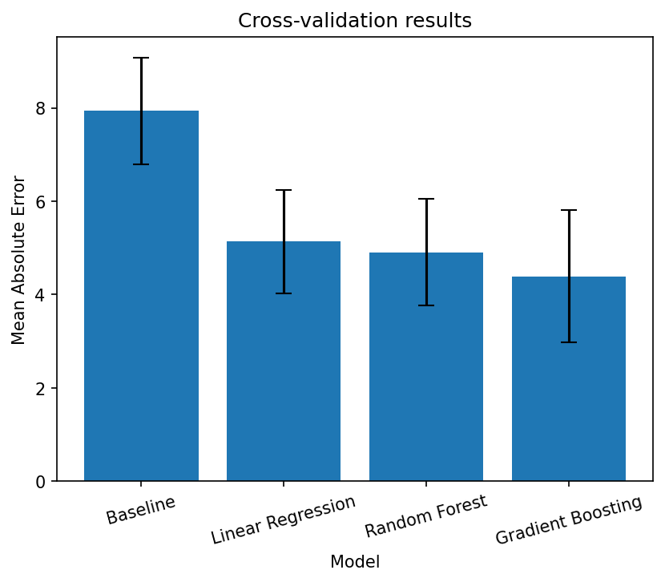
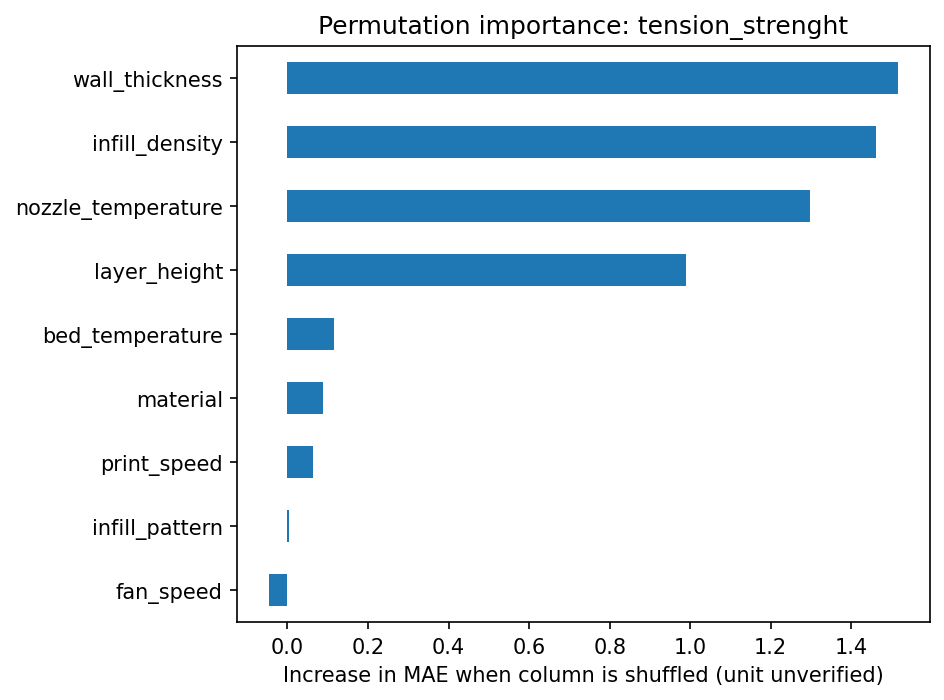

# Predicting FDM Print Quality from Process Settings

> A Python/Google Colab project that predicts how strong a 3D print will be from its print settings, then tests whether those predictions can help pick better settings.

## Why I built this
- 3D printing by trial and error wastes material and time.
- I wanted to see how far a small dataset and a simple ML workflow could go toward predicting print strength before printing.
- This was a quick personal project to learn the ML workflow and get ready to apply ML to my capstone.

## Summary:
- Best model: gradient boosting, mean MAE 4.39 ± 1.41 for tensile strength
- Baseline MAE: 7.93 ± 1.14
- Gradient boosting can't be separated from the other two models
- Evaluated with 5-fold cross-validation repeated 10 times; units unverified

## Problem Statement:
- Print settings affect the strength, roughness, and elongation of the final print.
- Trial-and-error printing wastes material and time.
- Goal: predict print quality from settings, then search for the settings that give the best result.

## Data:
- Kaggle "3D Printer Dataset for Mechanical Engineers" (Ultimaker S5)
- 50 rows, 9 settings, 3 outputs (roughness, tensile strength, elongation)
- Outputs are whole numbers
- Units are not verified

## Methods:
- Target: tensile strength, measured with Mean Absolute Error (MAE)
- Preprocessing (one-hot encoding, scaling) sits inside each pipeline to prevent data leakage
- Models: baseline (mean), linear regression, random forest, gradient boosting, compared on identical folds with seed 42
- Standard deviation across overlapping folds is a rough noise gauge
- Feature importance: permutation importance on an 80/20 split (10 test rows)
- Optimization: differential_evolution

## Results:
All three trained models beat the baseline by more than the fold spread.

| Model | MAE (mean ± std) |
|---|---|
| Baseline (mean) | 7.93 ± 1.14 |
| Linear regression | 5.14 ± 1.11 |
| Random forest | 4.91 ± 1.14 |
| Gradient boosting | 4.39 ± 1.41 |

- Gradient boosting had the lowest MAE (4.39), but the gaps between the three models are smaller than the fold spread.
- Gradient boosting also has the largest spread (1.41), so I can't rank it above random forest or linear regression.
- Earlier notebook (archive/): tuning random forest moved MAE from 4.89 to 4.87. This is slightly optimistic because tuning and evaluation used the same folds.
- Wall thickness (1.32) and infill density (0.94) had the highest permutation importance, which makes sense since both add load-bearing material. Material mattered very little.
- Only 10 test rows, so the middle bars are noisy.

Takeaway: All three models beat the baseline, and the gaps among them are smaller than the fold spread.

Takeaway: Wall thickness and infill density, the settings that add load-bearing material, matter most.

## Predict-Then-Optimize:
- Searched combinations of values seen in the data for each setting, treating bed speed and fan speed as pairs that occur together
- Used differential_evolution with a roughness cap of 165.5 (median roughness, units unverified)
- Best predicted run: PLA, grid pattern (strength 33.24, roughness 164.84)
- Best real run in the data: ABS, grid pattern (strength 37, roughness 75), so the search found no better settings
- The roughness model is the weaker one: it reuses the tensile hyperparameters and was never cross-validated
- The gap of about 3.8 is smaller than the CV MAE, and changing the seed flipped the top pick from ABS to PLA, so I wouldn't trust these recommendations

## Challenges & Lessons
- **Challenge:** With 50 rows, the three models were too close to rank, and the optimizer's top pick changed with the random seed.
- **What I did:** Reported the noise (std across folds) next to every MAE, and said plainly that the search found no better settings.
- **Lesson:** With small datasets, models can look different on paper without being meaningfully better, so now I know to check the noise before ranking them.

## Limitations:
- Small sample (n = 50), so estimates are noisy and single-split evaluation is unreliable
- Units are not verified
- ABS was printed at 220–250 °C and PLA at 200–220 °C, so the model may be using temperature in place of material (untested)
- Bed speed and fan speed move together (r = 1.00), so their separate effects can't be told apart
- The roughness cap relies on untuned tensile hyperparameters with no cross-validation of its own

## Next Steps:
1. Verify units across all dataset attributes.
2. Tune and cross-validate separate models for roughness and elongation.
3. Collect more ABS and PLA data at overlapping printing temperatures.
4. Print the recommended settings to check the predictions.

## How to reproduce:
- Open FinalNotebook in Google Colab
- Upload data.csv to /content
- Runtime → Restart session and run all
- Local runs: pip install -r requirements.txt
